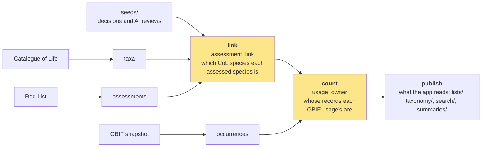

# The data sync

How the dashboard's data is built, why it works the way it does, and how to run it. The code is the reference: every builder's file opens with what its table holds (what a row is, what it is built from, its columns, its decisions). This explains the design and points to it. What happens after a sync, on every deploy, is in [build.md](build.md).



Only the two highlighted stages make judgements. If a number looks wrong, the cause is in `link/`, in `dbt/models/count/`, or in a seed.

Every table and what it reads, which shows how many moving parts there are behind those five boxes:


Generated: `python3 -I docs/diagrams/sync_overview.py <out.dot>`, then `neato -n2 -Tpng -Gdpi=110`.

## What a sync is

A sync is one immutable set of data files, named by the time it was uploaded (`syncs/2026-11-04T16-18-27Z/` in the `dashboard-data` R2 bucket). Production reads whichever sync `app/latest-sync.txt` names on `main`. Building and uploading a sync changes nothing anyone sees; merging the one-line `latest-sync.txt` change is what goes live, and reverting it goes back.

It is built monthly, on a local machine, from the inputs below and nothing else (it reads a 255 GiB GBIF mirror, which is why it doesn't run in CI). `npm run sync` takes about five minutes once the inputs are on disk; a new CoL release adds about 15 minutes, once, to index it for the matcher.

The design has one idea: **every number comes from four tables, by one rule.** The old sync answered "how many GBIF records does this species have?" separately for each place the number appeared, with two matching chains that disagreed, and each disagreement was a bug. Now the question has one answer, computed once.

## The stages

`app/scripts/sync/sync.ts` is the whole sync, read top to bottom: one section per stage, and in each a call per table, given the tables it reads.

| Stage | Folder | What it does |
|---|---|---|
| inputs | `inputs/` | fetch and cache each input: CoL, iNaturalist names, the GBIF snapshot (reduced once to per-usage counts), the matcher, BHL's names |
| 1 sources | `sources/` | each input as one clean table: `taxa`, `assessments`, `occurrences`, `occurrence_countries`, `common_names`, `literature_mentions`, the Specialist Groups' remits |
| 2 link | `link/` | which CoL species each assessed species is: `matches`, then `assessment_link` |
| 3 count | `dbt/models/count/` | whose records each GBIF usage's are: `usage_owner`, then each species' totals in `record_counts`, and its literature works in `paper_counts` (credited through the same ownership; a bare name in a paper goes to the species CoL accepts under it, so another author's synonym of that name filed elsewhere doesn't make it ambiguous) |
| 4 lists | `dbt/models/lists/` | what the app reads, joins only: `assessed`, assessment history, `species/`, `ne`, the app's `taxa`, `specialist_group_species` |
| 5 precomputed | `dbt/models/precomputed/`, `precomputed/` | the app's own queries run ahead of time: the CoL-differences tables and search indexes (SQL), then the summaries and CoL revision flags with the app's own code, so a precomputed number is the one its live view computes |
| 6 checks | `checks/` | fixtures and data tests (either stops the sync), the comparison with production |

Stages meet at a single table: `assessment_link` out of link, `usage_owner` out of count. Their columns are each stage's contract with the rest, so the inside of a stage can be rewritten without touching the others.

- **`seeds/`** holds every decision the sync applies, one file per kind and one row per decision with its reason: `ai-reviews.tsv` (the AI taxonomic reviewers' answers on the species listed for review, shown beside the records and never counted), `domesticated-and-humans.tsv` (domestic forms and humans), and the taxonomy tree's CoL homonyms and equivalents.
- **Count, lists and the precomputed SQL are dbt models** (`dbt/`, dbt-oss with DuckDB, installed by uv on first use). A model's `ref()`s are what it reads; its `.yml` holds its tests. `npm run sync:lineage` serves dbt's docs for the build: every model's SQL, columns, tests and lineage graph. By hand, from `app/scripts/sync/dbt`:

```bash
export SYNC_BUILD_DIR=$(git rev-parse --show-toplevel)/.sync SYNC_DATE=$(date +%F) SYNC_DUCKDB_TMP=~/.cache/redlist-dashboard/duckdb-tmp
uv run dbt build --profiles-dir . --select record_counts+    # a model and everything downstream of it
uv run dbt show --profiles-dir . --inline "select * from {{ ref('assessed') }} where id = 15951"
```

A run builds into `.sync/` at the repo root, in three folders, by what you do with them:

```
.sync/
  working/     what the stages pass to each other, never published: sources/ link/ count/ lists/,
               and dbt/ (its sync.duckdb, compiled SQL and logs)
  publish/     exactly what sync:publish uploads and what the app reads: lists/ taxonomy/ search/ summaries/,
               sync.json, sync.log
  review/      what you read before publishing: changes/ (report.md, the comparison with production),
               and links.parquet (every link, readable; to_review marks the ones waiting for a person)
```

A full run empties all three first, so nothing an older version wrote survives. Downloaded inputs stay in `~/.cache/redlist-dashboard/`, shared by every checkout.

## Inputs

Each is cached under `~/.cache/redlist-dashboard/` and fetched again only when its version moves.

| Input | What it gives | Version | Code |
|---|---|---|---|
| **Catalogue of Life XR** | every name usage, with lineage | the release the GBIF snapshot is filed under, not CoL's newest | `inputs/col-xr.ts` |
| **CoL curated release** | which species are curated, and which usages it holds | the one the XR was built from | `inputs/col-checklist.ts` |
| **IUCN Red List Postgres** | every global assessment, taxonomy, synonyms, credits | the database named by `DB_NAME` | `sources/assessments.ts` |
| **GBIF monthly snapshot** | every occurrence record, keyed by CoL id | newest mirrored date under `~/Data/gbif/` | `inputs/gbif-snapshot.ts` |
| iNaturalist taxonomy | one English common name per species | the calendar month | `inputs/inat-names.ts` |
| GBIF's name matcher | matching-ws, run locally in Docker | pinned (v1.0.12), indexed once per XR | `inputs/matcher.ts` |
| OpenAlex works | papers whose title or abstract names a CoL binomial | the newest release read in full; reading one takes days, so a sync never starts it (`npm run sync:openalex`; on a new machine run it once before the first sync, and it builds the CoL taxa it needs) | `inputs/openalex-snapshot.ts` |
| Biodiversity Heritage Library | the binomials BHL's name-finding confirmed on each scanned page | its monthly TSV export (2.5 GB, under `~/Data/bhl/`) | `inputs/bhl.ts` |

- **OpenAlex is kept as text, not mirrored.** The works snapshot is ~700 GiB, refreshed quarterly; each file is downloaded, reduced to the works that name a CoL binomial or sit in a biology or environment field (~15 GiB in all, `~/.cache/redlist-dashboard/openalex/<release>/works/`), and deleted. A changed name rule re-reads that, not the snapshot, but only finds names in what was kept: a work outside those fields is kept only when it names a binomial of the CoL release it was read against, so a new release's names, and capitals or abbreviation-only mentions, reach those works at the next quarterly read.
- **The Red List database is a colleague's.** It is opened read-only, and the build asks Postgres to confirm that before reading anything.
- **A snapshot is only exact if it is complete.** GBIF's mirrors silently lacked one file in twenty from 2025-07 to 2026-10 ([gbif/occurrence#609](https://github.com/gbif/occurrence/issues/609)), so the build refuses a snapshot with gaps in its file numbering, or whose row count doesn't match the GBIF download it came from.

Since October 2026 GBIF indexes records against the CoL XR, so **a GBIF taxon key is a CoL id**. That is what makes one taxonomy possible: matching an assessed species to CoL also decides its GBIF records.

## The counting rule

> A species counts the records of every usage whose `species_id` is that species (its own name, its synonyms, its subspecies, their BINs), **minus usages a separately assessed species owns**.

`usage_owner` is that rule as a table: for every CoL usage whose records count, the one species they count for. Every GBIF number on the dashboard is `occurrences` joined to it, with a different filter: georeferenced or all records, since the assessment date, by country, by group. A usage has at most one owner; `usage_owner` refuses to build if any has two.

**Ownership** is what "minus" means. Most assessed species simply own their CoL species and everything under it. The exceptions come from IUCN and CoL drawing species boundaries differently:

- **A split.** IUCN assesses *Zosterops simplex*; CoL files it as a subspecies of *Z. japonicus*. *Z. simplex* owns that subspecies, and *Z. japonicus* counts everything else.
- **A lump.** IUCN assesses *Fringilla polatzeki*; CoL files the name as a synonym under the subspecies *F. teydea polatzeki*. *F. polatzeki* owns the usages bearing its name, and only those. Where CoL files the name under several species, it owns each one by the same authors, not another author's homonym (*Ilex wallichii* Hook.f., not Steudel's).

**Two record modes.** Every count is published twice, and the Georeferenced / All records toggle (`src/lib/gbif-records.ts`) picks one for the whole page. *All records* (the default) is every record, the number gbif.org shows; *georeferenced* is the ones with coordinates and no geospatial issue. Both count every record type, museum specimens and fossils included. A species with no records in a mode reads 0; its since-assessment count is NULL only when there is no window (an undated assessment, or one after the sync).

### Worked examples

From sync `2026-11-04T16-18-27Z`, georeferenced records.

| Species | What CoL does | Counted | Total |
|---|---|---|---:|
| *Quercus robur* | accepted, same name | its species, all usages under it | 1,548,346 |
| *Zosterops japonicus* | accepted; a split sits under it | its species, minus *Z. simplex*'s 572,306 | 298,292 |
| *Zosterops simplex* | a subspecies of *Z. japonicus* | that subspecies and everything under it | 572,306 |
| *Hylatomus pileatus* | holds the Pileated Woodpecker twice: *H. pileatus* (156) and *Dryocopus pileatus* (5.2M) | both halves (each *is*) | 5,229,882 |
| *Fringilla polatzeki* | a synonym filed under the subspecies *F. teydea polatzeki* | its own usages only, not *F. teydea*'s 7,000+ | 715 |

## Matching: which CoL records represent an assessed species

**The rules are [docs/specs/matching.md](specs/matching.md)**, the source of truth: which CoL records each assessed species is (with a relation: *is*, *part of*, *split into* or *refused*), its doubts, the counting rule and the Not Evaluated list. This section is how to run and review it.

`link/`: `matches.ts` asks GBIF's matcher, matching-ws, running locally against the XR the sync uses, with the Red List lineage as hints and no authority; `select.ts` is the spec's selection, over `name-rules.ts`, the one name library; `select-inputs.ts` reads the build into it (`npm run sync:select` prints every species' selection); `ai-reviews.ts` reads `seeds/ai-reviews.tsv`; `assessment-link.ts` writes `assessment_link`, one row per record. The hardest part, and the most likely place for a wrong number: a species matched to the wrong CoL species shows someone else's records.


(The diagram predates the spec; `docs/diagrams/link_flow.py` is to be redrawn from it.)

**AI taxonomic review.** The rules settle every species; there are no overrides. Where they are in doubt, two AI taxonomic reviewers check: `npm run sync:ai-review -- review` (outside the sync; asks each species listed for review whose reviews don't apply, in two independent runs, priced first) writes one row per species and reviewer to **`seeds/ai-reviews.tsv`**: it agrees with the rules, suggests other records (listed, with their GBIF records), or can't tell, with its reason and sources; commit it. The sync shows the reviews in the match tooltip and never counts them. When both agree the species leaves the review list; when one suggests other records it gets the doubt `reviewer suggests other records`, which the dashboard flags as "AI reviewer suggests other records". Every row names the call behind it (`transcript`): the whole conversation, its searches, the pages it read and its answer, uploaded to a private B2 bucket (`B2_TRANSCRIPTS_*` in `app/.env.local`) after a scan for secrets, before the row is written; the dashboard links each one (`/ai-review/<key>`), and `npm run sync:trace -- "<species>"` shows them. A review is keyed by the rules' answer by names (CoL ids move) and a hash of what the reviewers were given; a release that changes either lists the species again, and the next run asks it again. The run prints the patterns among the suggestions: many of one kind are a rule to change.

**The review queue.** `assessment_link.to_review` (on the primary row) says why a person needs to look: the first doubt with all of them, or the reason nothing was taken; cleared when both AI taxonomic reviewers agree. `.sync/review/links.parquet` has every row with the names, versions and evidence beside it. `sync.json`'s `matching` records the counts by basis, step and doubt, and the queue by kind.

**What the app shows of a match.** `lists/assessed.parquet` carries each species' `match_reason`, `match_doubts`, `match_counts`, `match_treatment`, `match_other_names`, and for any match that isn't one plain name, `match_records`: the CoL records involved, each counted, also counted, or named only, with its share of the all-records count (the records under it, or under a usage below it no closer listed record claims; what none claims is listed by the CoL species it falls under, so the shares sum to the count). The GBIF matching reconciliation card has a bar per doubt (⚑) and per kind of match; once a bar is selected the app marks each count (⚑ in doubt, ⓘ otherwise), and the marker's tooltip shows the Red List name and each CoL record with its share and links to ChecklistBank and GBIF. `match_note` keeps the same facts in sentences for reviewers.

`.sync/review/links.parquet` columns a review reads first:

| Column | Answers | Values |
|---|---|---|
| `relation` | what the record is to the species | `is`, `part of`, `split into`, `refused`; `none` (nothing taken, or a candidate row); `duplicate` (another species owns it) |
| `match_reason` | how the Red List name found its record | `exact, unique`, `exact, homonym, author decides`, `exact, duplicate in CoL`, `spelling variant` (and `, …`), or why nothing was taken (`no candidate`, `informal or qualified name`). A covered row's says why it is there: `CoL duplicate` (`, respelled`, `, Red List synonym`), `name under another species`, `refused`, `Red List synonym, split` / `, filed elsewhere` / `, assessed separately`, `candidate`, `other group` |
| `col_treatment` | what CoL makes of the record | `accepted`, `synonym, other name`, `synonym, other spelling`, `lumped, unassessed`, `lumped, assessed`, `split`; a covered row's, the record's CoL status |
| `counts` | what the row counts | `the whole CoL species`, `only records under its own name`, `nothing` |
| `match_description` | the row in one sentence, with names, authors and ids | "GBIF's matcher answered *Sorbus greenii* T.C.G.Rich [..], synonym of *Aria greenii* … Counts every record of *Aria greenii*." |

**Accuracy** is measured outside the sync by the AI taxonomic reviewers (the spec's last section): `npm run sync:ai-review -- first` (or `changed --baseline <old.json>` for a rule change). **A rule change** is checked by `npm run sync:rebuild-check`, which has an agent rebuild the selection from the spec alone and compares.

### Versions


Generated from a build and GBIF's live index: `python3 -I docs/diagrams/versions.py .sync <out.dot>`, then `dot -Tpng -Gdpi=110`. The orange arrows are the ones a person has to keep right.

A link is between one Red List release and one CoL release, both recorded in `sync.json` and named in the footer. The CoL release is the XR the GBIF snapshot is filed under: every occurrence carries that XR's ids, so it is the only release the records can be counted in without guessing. Everything CoL-related uses it, including the CoL-differences card, so a page describes one taxonomy.

It trails CoL's newest by up to a few months: GBIF re-indexes a few times a year, and the next snapshot catches up. Following CoL's newest instead was tried and dropped (PR #626): it meant guessing where GBIF's next re-index would file each record, and the guess failed silently. GBIF's *live* API moves before the snapshot does, so the app's live panels also ask with the id GBIF's matcher gives our name in its newer release (`src/lib/gbif-live-keys.ts`, see [app.md](app.md)).

## The Not Evaluated list

Every *described* CoL species (`species/`'s `described`: accepted, curated, not extinct, not domesticated or human per `seeds/domesticated-and-humans.tsv`) that no assessed species counts whole, with or without GBIF records (the rule is [the spec's](specs/matching.md#counting-and-the-ne-list)). `ne.parquet`, built by `dbt/models/lists/ne.sql` and keyed by `col_id` (also its GBIF key), adds the counts for those with records. Two notes ride on `species/`: `may_be_assessed`, the assessed species with a doubt it may be, which the app flags, and `assessed_here`, assessed species whose part-of records lie under it or whose name it holds, which the app shows as a note.

## What the app reads

`.sync/publish/` is exactly what is uploaded to `syncs/<timestamp>/` and what `app/data/sync/` holds after a fetch. [`src/lib/data/sync-layout.ts`](../app/src/lib/data/sync-layout.ts) is the one list of its files; what reads each is in [app.md](app.md).

| Folder | What |
|---|---|
| `lists/` | `assessed.parquet` (one row per assessed species), `regional-assessed.parquet` (the same columns plus `region`, one row per species and region, from regional assessments; the dashboard reads it under `?scope=`), `assessments.parquet` (history), `regional-assessments.parquet` (the same per region, for the Red List tab's scope switch), `ne.parquet`, `species/` (every accepted CoL species, by group) |
| `taxonomy/` | the app's `taxa` and `assessment_link`, the CoL-differences files, the tree's common names |
| `search/` | the name, rank and synonym indexes |
| `summaries/` | per-group and per-country totals |
| | `sync.json` (every input version and check result) and `sync.log` (everything the run printed) |

Two files go into the repo instead, because client code imports them at build time: `src/config/col-release.json` and `src/config/col-taxon-ids.json`. That is why a data PR after a CoL release move touches `src/config/` too.

## Checks

- **Invariants stop the build**: the Red List session is read-only, the snapshot complete, each GBIF usage counts towards at most one species, every domesticated-species name is an accepted CoL species, Specialist Group membership covers its sections, and the occurrence table holds exactly the snapshot's records.
- **Matching fixtures stop the build**: `checks/fixtures/matching.ts` holds the named cases, each a species that once showed the wrong number, or an example of the spec, with what must stay true of it: the link, the GBIF key, the records, the NE list, its doubts (exactly) and the records it counts with their relations (`selected`). **Every label and doubt has one:** the build stops if it gives any species a `match_reason` or doubt no case names, so a new rule arrives with a real species to read it by. Expectations are by name, since CoL renumbers about 2% of ids each release, with the authorities that tell homonyms apart, compared as authors. Each says which releases it last passed on (`confirmed`), so a failure says whether it is a regression in the code or the data moving; a `why` that no longer holds ends with an update saying when, against which release, and what the data shows now.
- **Data tests stop publishing**: assessed totals per group against IUCN's Table 1a, the tree's summaries against its config, and so on (`DATA_TESTS` in `sync.ts`). When the Red List publishes, `validate-table1a.test.ts` fails until updated: that is its job.
- **The comparison is for review**: `checks/compare.ts` diffs the new sync against production's, field by field, and gives each difference a reason from `compare/reasons.ts` or marks it unexplained. A reason must be bounded by what the change predicts, or it can hide a bug. Read the unexplained list by size, **falls first**: a number dropping is where a matching regression shows.

## Running it each month

GBIF publishes a snapshot on the 1st of each month ([registry](https://registry.opendata.aws/gbif/)).

```bash
# 1. Mirror the new snapshot (~255 GiB, public, no account; hours)
uvx --from awscli aws s3 sync s3://gbif-open-data-eu-central-1/occurrence/<date>/ ~/Data/gbif/<date>/ --no-sign-request

# 2. Build and check (about five minutes once inputs are cached)
cd app && npm run sync

# 3. Read .sync/review/changes/report.md, and the links waiting for a person: .sync/review/links.parquet WHERE to_review IS NOT NULL

# 4. Publish: copies .sync/publish/ into app/data/sync, uploads it to a new syncs/<timestamp>/, bumps latest-sync.txt
npm run sync:publish

# 5. Open the data PR with the git add line it prints. Merging it is what goes live.
```

Needs Docker (the matcher), uv (dbt), the Red List Postgres (`DB_*` in `app/.env.local`), and R2 credentials.

**When CoL moves.** A new XR renumbers about 2% of ids and moves names between species, so expect a few thousand link and count differences that month. The sync takes the XR GBIF indexes now, but a snapshot is filed under the XR GBIF indexed when it was made; between GBIF moving and the next snapshot they disagree, and the build stops. For that month, set `COL_XR_DATASET` to the snapshot's XR (the one `src/config/col-release.json` names).

**When IUCN publishes.** Point `DB_NAME` at the new database and update `validate-table1a.test.ts`. When both move in one month, build one change at a time so each comparison explains one source:

```bash
PIPELINE_BUILD_DIR=../.sync2 npm run sync                        # snapshot + XR, against production
DB_NAME=<new> npm run sync -- --baseline ../.sync2/data           # + Red List, against that
```

**Rolling back.** Revert the data PR's `latest-sync.txt` change; every earlier sync stays in R2.

**Running parts.** `npm run sync -- --from <stage>` (`link`, `count`, `lists`, `precomputed`, `checks`) reuses the build's earlier tables, and refuses if the releases it resolves differ from the build's. `--skip-compare` skips the comparison; `--baseline <data dir>` compares against another build. `PIPELINE_BUILD_DIR` builds elsewhere; `GBIF_SNAPSHOT=<date>` pins a snapshot.

### Tracing a species

`npm run sync:trace -- "<Red List name or SIS id>"` prints why a species is linked as it is, from the build, in the order the sync decides it:

1. **The name:** GBIF's matcher's answer, and the points it gave it and every other candidate (name, authorship, classification, rank, status), and the AI taxonomic reviews if there are any, with each one's searches and pages.
2. **The selection:** the step, the doubts, and each link row: the CoL taxon and species it names, its relation, `match_reason`, `col_treatment` and `counts`, and its description.
3. **The count:** every CoL record whose GBIF records count for it, and the totals the app shows.

```
$ npm run sync:trace -- "Cipangopaludina chinensis"
1. The name
  The matcher answered: Cipangopaludina chinensis (J. E. Gray, 1833) [VFND, ambiguous_synonym species], EXACT, 100% sure
    points: name 110, authorship 0, classification 50, rank 6, status -1 = 165
  Other candidates it weighed:
    Cipangopaludina chinensis (Gray, 1834) [VHXLS, provisionally_accepted species]: name 110, ..., status -5 = 161
  Decision (decisions.tsv), by fixture, reviewed, 2026-11-10: checks/fixtures/matching.ts: CoL provisionally accepts exactly this name; …
    is: Cipangopaludina chinensis (Gray, 1834) [VHXLS, provisionally accepted, of Cipangopaludina chinensis]
2. The selection
  Step 1; doubts: none
  primary  CoL species Cipangopaludina chinensis (Gray, 1834) [VHXLS]
  ...
```

Everything it prints is in the build's tables, so anything it shows can be checked with DuckDB directly: `matches.parquet` holds the matcher's answers and points (`matcher_score`, and the candidates in `alternatives`, each with its `score`: both JSON text), the accepted species each synonym leads to and each candidate's lineage (kingdom to family), and the matching-ws release and XR that answered (`matcher_version`, `matcher_xr`), and `assessment_link.parquet` the link rows, with `match_reason`, `col_treatment`, `counts`, `match_description` and `to_review`.

## Decisions and known limits

Choices made on purpose:

- **IUCN's group for assessed species, CoL's for the rest**, so Table 1a stays exact.
- **Only a species counted whole leaves the NE list**: a record counted only under its own name, or refused, leaves the rest of its species there, with a note.
- **Outdated is as of the sync date**, so a page's numbers don't drift between syncs.
- **One CoL release for everything**, named in the footer.
- **Every decision is a seed**, with its reason, not a constant in code.

Known limits (sync of 16 November 2026):

- 245 species have no match and count nothing: 146 informal or unpublished names CoL doesn't hold (sp. nov., aff., cf., an ined. name not in CoL), 92 where CoL has nothing at species level to pick, 5 synonyms of no species and 2 misapplied names. 713 more count through a flagged match (homonyms the authors don't settle, picks by the author citation where the matcher answers only the genus or a homonym the citation rules out, different spellings, lower confidence, synonyms by other authors, ambiguous names), shown with ⚑. A flagged species that newly counts takes the records under its own name from the broader CoL species, as any lumped species does (*Polygonum punctatum* from *Persicaria punctata*).
- Ownership walks three levels below a lumped species' root; a deeper case would go uncounted.
- BOLD BINs filed under a genus or family stay unresolved, as GBIF leaves them.
- NE country lists come from the snapshot, so differ a little from gbif.org's live counts.
- The link's concept rules are checked against real data only (the fixtures); the acceptance rule, the reviews and counting rule also have unit tests.
- `assessed.parquet` keeps lists as `;`-joined strings, because the app's filter SQL expects them.
