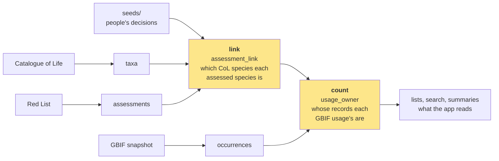

# The data sync

How the dashboard's data is built, why it works the way it does, and how to run it. The code is the reference: every builder's file opens with what its table holds (what a row is, what it is built from, its columns, its decisions). This explains the design and points to it. What happens after a sync, on every deploy, is in [build.md](build.md).



Only the two highlighted stages make judgements. If a number looks wrong, the cause is in `link/`, in `dbt/models/count/`, or in a seed.

Every table and what it reads, which shows how many moving parts there are behind those five boxes:


Generated: `python3 -I docs/diagrams/sync_overview.py <out.dot>`, then `neato -n2 -Tpng -Gdpi=110`.

## What a sync is

A sync is one immutable set of data files, named by the time it was uploaded (`syncs/2026-11-04T16-18-27Z/` in the `dashboard-data` R2 bucket). Production reads whichever sync `app/latest-sync.txt` names on `main`. Building and uploading a sync changes nothing anyone sees; merging the one-line `latest-sync.txt` change is what goes live, and reverting it goes back.

It is built monthly, on a local machine, from the inputs below and nothing else (it reads a 255 GiB GBIF mirror, which is why it doesn't run in CI). `npm run sync` takes about five minutes once the inputs are on disk; a new CoL release adds about 15 minutes, once, to index it for the matcher.

The design has one idea: **every number comes from four tables, by one rule.** The old sync answered "how many GBIF records does this species have?" separately for each place the number appeared, with two matching chains that disagreed, and each disagreement was a bug. Now the question has one answer, computed once.

## The stages

`app/scripts/sync/sync.ts` is the whole sync, read top to bottom: one section per stage, and in each a call per table, given the tables it reads.

| Stage | Folder | What it does |
|---|---|---|
| inputs | `inputs/` | fetch and cache each input: CoL, iNaturalist names, the GBIF snapshot (reduced once to per-usage counts), the matcher |
| 1 sources | `sources/` | each input as one clean table: `taxa`, `assessments`, `occurrences`, `occurrence_countries`, `common_names`, the Specialist Groups' remits |
| 2 link | `link/` | which CoL species each assessed species is: `matches`, then `assessment_link` |
| 3 count | `dbt/models/count/` | whose records each GBIF usage's are: `usage_owner`, then each species' totals in `record_counts` |
| 4 lists | `dbt/models/lists/` | what the app reads, joins only: `assessed`, assessment history, `species/`, `ne`, the app's `taxa`, `specialist_group_species` |
| 5 precomputed | `dbt/models/precomputed/`, `precomputed/` | the app's own queries run ahead of time: the CoL-differences tables and search indexes (SQL), then the summaries and CoL revision flags with the app's own code, so a precomputed number is the one its live view computes |
| 6 checks | `checks/` | fixtures and data tests (either stops the sync), the comparison with production |

Stages meet at a single table: `assessment_link` out of link, `usage_owner` out of count. Their columns are each stage's contract with the rest, so the inside of a stage can be rewritten without touching the others.

- **`seeds/`** holds every decision a person made, one file per kind and one row per decision with its reason: `decisions.tsv` (which CoL name a hard-to-match species is), `ne-excluded.tsv` (domestic forms and humans), `forced-latest.tsv`, and the taxonomy tree's CoL homonyms and equivalents.
- **Count, lists and the precomputed SQL are dbt models** (`dbt/`, dbt-oss with DuckDB, installed by uv on first use). A model's `ref()`s are what it reads; its `.yml` holds its tests. `npm run sync:lineage` serves dbt's docs for the build: every model's SQL, columns, tests and lineage graph. By hand, from `app/scripts/sync/dbt`:

```bash
export SYNC_BUILD_DIR=$(git rev-parse --show-toplevel)/.sync SYNC_DATE=$(date +%F) SYNC_DUCKDB_TMP=~/.cache/redlist-dashboard/duckdb-tmp
uv run dbt build --profiles-dir . --select record_counts+    # a model and everything downstream of it
uv run dbt show --profiles-dir . --inline "select * from {{ ref('assessed') }} where id = 15951"
```

A run builds into `.sync/` at the repo root: `core/` holds the working tables, one folder per stage (`core/sources/`, `core/link/`, `core/count/`, `core/lists/`), and `data/` the published sync. A full run empties both first, so nothing an older version wrote survives. Downloaded inputs stay in `~/.cache/redlist-dashboard/`, shared by every checkout.

## Inputs

Each is cached under `~/.cache/redlist-dashboard/` and fetched again only when its version moves.

| Input | What it gives | Version | Code |
|---|---|---|---|
| **Catalogue of Life XR** | every name usage, with lineage | the release the GBIF snapshot is filed under, not CoL's newest | `inputs/col-xr.ts` |
| **CoL curated release** | which species are curated, and which usages it holds | the one the XR was built from | `inputs/col-checklist.ts` |
| **IUCN Red List Postgres** | every global assessment, taxonomy, synonyms, credits | the database named by `DB_NAME` | `sources/assessments.ts` |
| **GBIF monthly snapshot** | every occurrence record, keyed by CoL id | newest mirrored date under `~/Data/gbif/` | `inputs/gbif-snapshot.ts` |
| iNaturalist taxonomy | one English common name per species | the calendar month | `inputs/inat-names.ts` |
| GBIF's name matcher | matching-ws, run locally in Docker | pinned (v1.0.12), indexed once per XR | `inputs/matcher.ts` |

- **The Red List database is a colleague's.** It is opened read-only, and the build asks Postgres to confirm that before reading anything.
- **A snapshot is only exact if it is complete.** GBIF's mirrors silently lacked one file in twenty from 2025-07 to 2026-10 ([gbif/occurrence#609](https://github.com/gbif/occurrence/issues/609)), so the build refuses a snapshot with gaps in its file numbering, or whose row count doesn't match the GBIF download it came from.

Since October 2026 GBIF indexes records against the CoL XR, so **a GBIF taxon key is a CoL id**. That is what makes one taxonomy possible: matching an assessed species to CoL also decides its GBIF records.

## The counting rule

> A species counts the records of every usage whose `species_id` is that species (its own name, its synonyms, its subspecies, their BINs), **minus usages a separately assessed species owns**.

`usage_owner` is that rule as a table: for every CoL usage whose records count, the one species they count for. Every GBIF number on the dashboard is `occurrences` joined to it, with a different filter: georeferenced or all records, since the assessment date, by country, by group. A usage has at most one owner; `usage_owner` refuses to build if any has two.

**Ownership** is what "minus" means. Most assessed species simply own their CoL species and everything under it. The exceptions come from IUCN and CoL drawing species boundaries differently:

- **A split.** IUCN assesses *Zosterops simplex*; CoL files it as a subspecies of *Z. japonicus*. *Z. simplex* owns that subspecies, and *Z. japonicus* counts everything else.
- **A lump.** IUCN assesses *Rubus fruticosus*; CoL treats the name as a synonym under three species. *R. fruticosus* owns the three synonym usages bearing its name, and only those.

**Two record modes.** Every count is published twice, and the Georeferenced / All records toggle (`src/lib/gbif-records.ts`) picks one for the whole page. *All records* (the default) is every record, the number gbif.org shows; *georeferenced* is the ones with coordinates and no geospatial issue. Both count every record type, museum specimens and fossils included. A species with no records in a mode reads 0; its since-assessment count is NULL only when there is no window (an undated assessment, or one after the sync).

### Worked examples

From sync `2026-11-04T16-18-27Z`, georeferenced records.

| Species | What CoL does | Counted | Total |
|---|---|---|---:|
| *Quercus robur* | accepted, same name | its species, all usages under it | 1,548,346 |
| *Zosterops japonicus* | accepted; a split sits under it | its species, minus *Z. simplex*'s 572,306 | 298,292 |
| *Zosterops simplex* | a subspecies of *Z. japonicus* | that subspecies and everything under it | 572,306 |
| *Hylatomus pileatus* | holds the Pileated Woodpecker twice: *H. pileatus* (156) and *Dryocopus pileatus* (5.2M) | both halves (a covered duplicate) | 5,229,882 |
| *Fringilla polatzeki* | a synonym filed under the subspecies *F. teydea polatzeki* | its own usages only, not *F. teydea*'s 7,000+ | 715 |
| *Rubus fruticosus* | a synonym under three different species | its three same-name synonym usages | 120,505 |

## Matching: which CoL species an assessed species is

`link/`: `matches.ts`, `accept-match.ts`, `decisions.ts` (with `seeds/decisions.tsv`) and `assessment-link.ts`. The hardest part, and the most likely place for a wrong number: a species matched to the wrong CoL species shows someone else's records.


Generated from a build, with a real species on every branch: `python3 -I docs/diagrams/link_flow.py <build dir> <out.dot>`, then `dot -Tpng -Gdpi=110`. It stops if an example no longer takes its branch.

Matching is two questions, answered separately so each can be explained on its own.

### 1. The name: which CoL name is the Red List name?

Every assessed species' name goes to **[matching-ws](https://github.com/gbif/matching-ws)**, the matcher GBIF files occurrence records with, with IUCN's kingdom-to-family lineage as hints. It runs locally against the exact XR the sync uses, so a name matched here lands where GBIF filed that name's records. It finds the CoL usages spelled the same or nearly so, scores each on name, authority, hints, rank and status, and takes the best.

The authority is deliberately not sent: most records carry none, and asked with it the matcher prefers whichever CoL record has the identical author string, often a provisional duplicate the records aren't on (measured: 301 species lost 42.6M records). The authority does its work after the match.

The answer is taken without review (`accept-match.ts`) when:

> the name is found exactly, as a species, with full confidence, it leads to an accepted CoL species, and no other CoL name spelled the same way leads to a different species, unless the author citation picks one.

A person decides instead when the Red List marks the name as unsettled (aff., cf., sp., ined., sensu…), when the match is a synonym by other authors than the Red List's (COL26.10 dropped *Tritoma bipustulata* Fabricius, 1775, and what's left is Schilsky's, a synonym of another beetle), and in every other case the rule doesn't settle. Author citations are compared in one place, `app/src/lib/authors.ts`.

Those cases go to **`seeds/decisions.tsv`**: one row per species, naming the CoL name (and authorship, to tell homonyms apart), who decided, whether a person has reviewed it, and the evidence. It is keyed by SIS id and names, not CoL ids, which move between releases; a decision is asked again when its names stop resolving or the Red List renames the species. A decision always beats the matcher. The queue of species waiting is written each sync to `.sync/match-queue.tsv` with the reason and the matcher's suggestion. Undecided species link to nothing; the app shows a dash in their GBIF columns, not 0.

### 2. The concept: what does that CoL name make the species?

`assessment_link.method` says what kind of usage it is; the verdict comes from `decideKey` in `link/species-key.ts`.

- **An accepted species is the species.**
- **A synonym is the species renamed (*own*), or a lump (*lumped*)**: CoL folds it into another species, so only its own usage, and anything under it, is its records. If CoL folds it into a species the Red List assesses separately, it is **refused** and counts nothing.
- **An ambiguous synonym** only counts records filed under that name.
- **No link crosses a phylum**: old genus names are homonyms across kingdoms (*Hepatus* was a fish and is a crab).
- **Covered rows**: where one organism sits under more than one accepted CoL species (*Hylatomus* / *Dryocopus pileatus*), each extra one is a *covered* row, which keeps it off the Not Evaluated list and, where the evidence is direct, counts its records too.
- **One owner per usage**: if two assessed species claim the same usage, one wins (primary before covered, *own* before *lumped*, matcher before decision, then lower SIS id) and the other becomes `duplicate`, counting nothing.

Every `assessment_link` row carries its verdict, method, basis and a sentence of reason, so any species' link can be explained from the table alone.

To review links, `dbt/analyses/link_audit.sql` gives every link with the evidence for checking it: how it was made, and where IUCN and CoL differ. It is a dbt analysis, run against a build when needed and not built each sync: `uv run dbt show --profiles-dir . --select link_audit` from `app/scripts/sync/dbt`. `sample_rank` orders each kind of link randomly, so reviewing its first n measures that kind's error rate.

### Versions

A link is between one Red List release and one CoL release, both recorded in `sync.json` and named in the footer. The CoL release is the XR the GBIF snapshot is filed under: every occurrence carries that XR's ids, so it is the only release the records can be counted in without guessing. Everything CoL-related uses it, including the CoL-differences card, so a page describes one taxonomy.

It trails CoL's newest by up to a few months: GBIF re-indexes a few times a year, and the next snapshot catches up. Following CoL's newest instead was tried and dropped (PR #626): it meant guessing where GBIF's next re-index would file each record, and the guess failed silently. GBIF's *live* API moves before the snapshot does, so the app's live panels also ask with the id GBIF's matcher gives our name in its newer release (`src/lib/gbif-live-keys.ts`, see [app.md](app.md)).

## The Not Evaluated list

`ne.parquet`, built by `dbt/models/lists/ne.sql`, keyed by `col_id` (also its GBIF key). A CoL species is on it when it is *described* (`species/`'s `described`: accepted, curated, not extinct, not domesticated or human per `seeds/ne-excluded.tsv`), no assessed species links to it by any row, and GBIF has records for it under the counting rule.

## What the app reads

`.sync/data/` is exactly what is uploaded to `syncs/<timestamp>/` and what `app/data/sync/` holds after a fetch. [`src/lib/data/sync-layout.ts`](../app/src/lib/data/sync-layout.ts) is the one list of its files; what reads each is in [app.md](app.md).

| Folder | What |
|---|---|
| `lists/` | `assessed.parquet` (one row per assessed species), `assessments.parquet` (history), `ne.parquet`, `species/` (every accepted CoL species, by group) |
| `taxonomy/` | the app's `taxa` and `assessment_link`, the CoL-differences files, the tree's common names |
| `search/` | the name, rank and synonym indexes |
| `summaries/` | per-group and per-country totals |
| | `sync.json` (every input version and check result) and `sync.log` (everything the run printed) |

Two files go into the repo instead, because client code imports them at build time: `src/config/col-release.json` and `src/config/col-taxon-ids.json`. That is why a data PR after a CoL release move touches `src/config/` too.

## Checks

- **Invariants stop the build**: the Red List session is read-only, the snapshot complete, each GBIF usage counts towards at most one species, every domesticated-species name is an accepted CoL species, Specialist Group membership covers its sections, and the occurrence table holds exactly the snapshot's records.
- **Matching fixtures stop the build**: `checks/fixtures/matching.ts` holds 50 named cases, each a species that once showed the wrong number, with what must stay true of it. Expectations are by name, since CoL renumbers about 2% of ids each release. Reading it next to `link/assessment-link.ts` is the quickest way to see what each rule is for.
- **Data tests stop publishing**: assessed totals per group against IUCN's Table 1a, the tree's summaries against its config, and so on (`DATA_TESTS` in `sync.ts`). When the Red List publishes, `validate-table1a.test.ts` fails until updated: that is its job.
- **The comparison is for review**: `checks/compare.ts` diffs the new sync against production's, field by field, and gives each difference a reason from `compare/reasons.ts` or marks it unexplained. A reason must be bounded by what the change predicts, or it can hide a bug. Read the unexplained list by size, **falls first**: a number dropping is where a matching regression shows.

## Running it each month

GBIF publishes a snapshot on the 1st of each month ([registry](https://registry.opendata.aws/gbif/)).

```bash
# 1. Mirror the new snapshot (~255 GiB, public, no account; hours)
uvx --from awscli aws s3 sync s3://gbif-open-data-eu-central-1/occurrence/<date>/ ~/Data/gbif/<date>/ --no-sign-request

# 2. Build and check (about five minutes once inputs are cached)
cd app && npm run sync

# 3. Read .sync/compare/report.md, and .sync/match-queue.tsv for species waiting on a decision

# 4. Publish: copies the build into app/data/sync, uploads it to a new syncs/<timestamp>/, bumps latest-sync.txt
npm run sync:publish

# 5. Open the data PR with the git add line it prints. Merging it is what goes live.
```

Needs Docker (the matcher), uv (dbt), the Red List Postgres (`DB_*` in `app/.env.local`), and R2 credentials.

**When CoL moves.** A new XR renumbers about 2% of ids and moves names between species, so expect a few thousand link and count differences that month. The sync takes the XR GBIF indexes now, but a snapshot is filed under the XR GBIF indexed when it was made; between GBIF moving and the next snapshot they disagree, and the build stops. For that month, set `COL_XR_DATASET` to the snapshot's XR (the one `src/config/col-release.json` names).

**When IUCN publishes.** Point `DB_NAME` at the new database and update `validate-table1a.test.ts`. When both move in one month, build one change at a time so each comparison explains one source:

```bash
PIPELINE_BUILD_DIR=../.sync2 npm run sync                        # snapshot + XR, against production
DB_NAME=<new> npm run sync -- --baseline ../.sync2/data           # + Red List, against that
```

**Rolling back.** Revert the data PR's `latest-sync.txt` change; every earlier sync stays in R2.

**Running parts.** `npm run sync -- --from <stage>` (`link`, `count`, `lists`, `precomputed`, `checks`) reuses the build's earlier tables, and refuses if the releases it resolves differ from the build's. `--skip-compare` skips the comparison; `--baseline <data dir>` compares against another build. `PIPELINE_BUILD_DIR` builds elsewhere; `GBIF_SNAPSHOT=<date>` pins a snapshot.

### Tracing a species

The core tables are plain parquet; DuckDB reads them directly.

```sql
-- in duckdb, from .sync/core
SET VARIABLE sp = 'Zosterops simplex';

-- its link rows: what it is in CoL, and why
SELECT l.role, l.verdict, l.method, c.scientific_name AS col_species, u.scientific_name AS records_start_at, l.counted, l.reason
FROM 'link/assessment_link.parquet' l
JOIN 'sources/assessments.parquet' a ON a.sis_taxon_id = l.sis_taxon_id AND a.is_latest
LEFT JOIN 'sources/taxa.parquet' c ON c.col_id = l.col_id
LEFT JOIN 'sources/taxa.parquet' u ON u.col_id = l.usage_id
WHERE a.scientific_name = getvariable('sp');

-- what its count is made of: each usage it owns, and its records
SELECT w.link_usage_id, u.scientific_name AS usage, u.rank, u.status, sum(o.n) FILTER (o.georef) AS georef, sum(o.n) AS all_records
FROM 'count/usage_owner.parquet' w JOIN 'sources/taxa.parquet' u ON u.col_id = w.usage_key
LEFT JOIN 'sources/occurrences.parquet' o ON o.usage_key = w.usage_key
WHERE w.sis_taxon_id = (SELECT sis_taxon_id FROM 'sources/assessments.parquet' WHERE is_latest AND scientific_name = getvariable('sp'))
GROUP BY ALL ORDER BY georef DESC NULLS LAST;
```

## Decisions and known limits

Choices made on purpose:

- **IUCN's group for assessed species, CoL's for the rest**, so Table 1a stays exact.
- **IUCN's synonyms keep CoL species off the NE list**, even when their records aren't counted.
- **Outdated is as of the sync date**, so a page's numbers don't drift between syncs.
- **One CoL release for everything**, named in the footer.
- **Every human decision is a seed**, with its reason, not a constant in code.

Known limits (sync of 10 November 2026):

- 2,368 species are in the match queue: 753 spelling variants, 621 homonyms the authors don't decide, 322 with no species match, 172 informal names. 2,016 have a decision, all carried over from the old matching passes and none reviewed; 352 are undecided and count nothing.
- Ownership walks three levels below a lumped species' root; a deeper case would go uncounted.
- BOLD BINs filed under a genus or family stay unresolved, as GBIF leaves them.
- NE country lists come from the snapshot, so differ a little from gbif.org's live counts.
- The link's concept rules are checked against real data only (the fixtures); the acceptance rule, decisions and counting rule also have unit tests.
- `assessed.parquet` keeps lists as `;`-joined strings, because the app's filter SQL expects them.
